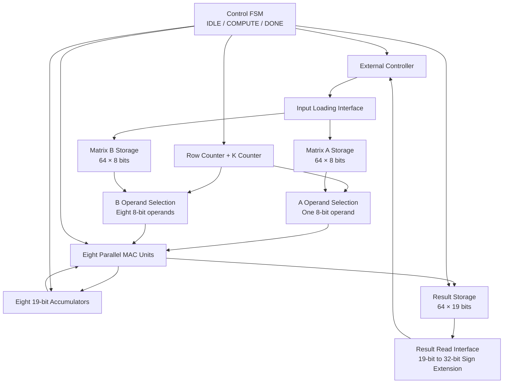
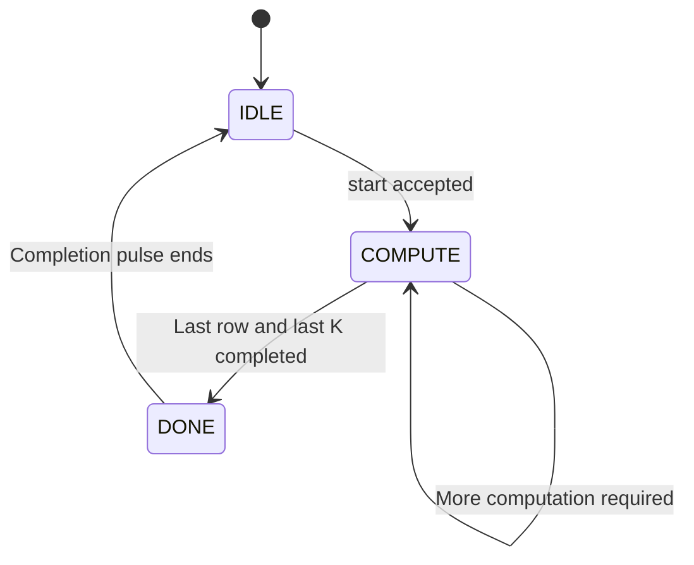

# Day 2 – Architecture Design
## 8×8 INT8 Matrix-Multiply Accelerator

## 1. Project Overview

The objective is to design an 8×8 INT8 matrix-multiply accelerator and implement it using SystemVerilog.

The accelerator performs matrix multiplication:

\[
C=A\times B
\]

where A, B and C are 8×8 matrices containing signed integer elements.

Each output element is calculated as:

\[
C_{ij}=\sum_{k=0}^{7} A_{ik}\times B_{kj}
\]

The architecture is designed to provide a balance between hardware area, computational throughput and physical implementation complexity.

### 1.1 Design Specifications

| Parameter | Specification |
|---|---|
| Design | INT8 Matrix-Multiply Accelerator |
| Matrix dimensions | 8×8 |
| Operand data type | Signed INT8 |
| Operand width | 8 bits |
| Matrix multiplication | C = A × B |
| Number of output elements | 64 |
| Number of multiplications | 512 |
| Number of accumulation additions | 448 |
| Clock domains | Single synchronous clock domain |
| Initial clock period | 10 ns (100 MHz) |
| Reset | Active-low asynchronous reset |
| RTL language | SystemVerilog |
| Synthesis tool | Yosys |
| Physical design tool | OpenROAD |
| Timing analysis | OpenSTA |
| Technology library | Sky130HD |
| Layout viewer | KLayout |

The 10 ns clock period is an initial design target for timing analysis. It is not a claim about the achieved operating frequency.

---

## 2. Architectural Alternatives

Three possible architectures were considered.

### 2.1 Architecture A – Single MAC Unit

This architecture consists of:
- One 8-bit signed multiplier.
- One accumulator.
- Input selection logic.
- A control FSM.

The same MAC unit is reused to calculate all 64 output elements.

Each output element requires eight multiplication-accumulation operations.

Total computation cycles:

\[
64\times8=512
\]

Advantages:
- Low hardware area.
- Simple datapath.
- Straightforward control logic.

Disadvantages:
- High execution latency.
- Limited computational parallelism.

### 2.2 Architecture B – Eight Parallel MAC Units

This architecture consists of:
- Eight signed 8-bit multipliers.
- Eight signed 19-bit accumulators.
- Operand selection logic.
- A control FSM.

Each MAC unit calculates one element of an output row.

For a particular output row, all eight columns are computed in parallel.

For example:

- MAC 0 calculates C[0][0].
- MAC 1 calculates C[0][1].
- MAC 2 calculates C[0][2].
- MAC 3 calculates C[0][3].
- MAC 4 calculates C[0][4].
- MAC 5 calculates C[0][5].
- MAC 6 calculates C[0][6].
- MAC 7 calculates C[0][7].

Each MAC unit performs one multiplication and one accumulation per clock cycle.

After eight computation cycles, the entire output row is available.

Total computation cycles:

\[
8\text{ rows}\times8\text{ cycles per row}=64
\]

Advantages:
- Good balance between hardware area and computational throughput.
- Eight output elements are computed in parallel.
- Moderate hardware complexity.
- Suitable for studying placement, timing and congestion optimization.

Disadvantages:
- Higher area than a single MAC architecture.
- Requires parallel access to eight elements of matrix B.
- Requires operand selection and control logic.

### 2.3 Architecture C – Sixty-Four Parallel MAC Units

This architecture consists of:
- Sixty-four multipliers.
- Sixty-four accumulators.
- Operand distribution logic.
- Control logic.

Each MAC unit computes one output matrix element.

All 64 output elements can be calculated concurrently, with each MAC performing eight accumulation operations.

Total computation cycles:

\[
8
\]

Advantages:
- High computational parallelism.
- Low computation latency.

Disadvantages:
- High hardware area.
- Increased routing demand.
- More complicated placement and physical implementation.
- Greater congestion risk.

### 2.4 Architecture Comparison

| Parameter | Single MAC | 8 MACs | 64 MACs |
|---|---:|---:|---:|
| Number of multipliers | 1 | 8 | 64 |
| Number of accumulators | 1 | 8 | 64 |
| Products per cycle | 1 | 8 | 64 |
| Computation cycles | 512 | 64 | 8 |
| Relative datapath area | Low | Moderate | High |

The cycle counts assume one multiplication-accumulation per MAC unit per cycle, without additional pipeline stalls.

### 2.5 Selected Architecture

**Architecture B – Eight Parallel MAC Units** is selected as the baseline architecture.

The architecture provides a reasonable balance between hardware resource requirements and computational throughput.

It also provides sufficient hardware complexity for investigating:
- Placement optimization.
- Timing closure.
- Congestion optimization.
- Area and timing trade-offs.
- Physical design effects of parallel datapaths.

---

## 3. Arithmetic Width Calculation

The input operands are signed 8-bit two's-complement integers.

Their numerical range is:

\[
-128\leq A_{ik},B_{kj}\leq127
\]

### 3.1 Multiplier Output Width

Each multiplication involves two signed 8-bit operands.

The maximum positive product is:

\[
(-128)\times(-128)=16384
\]

The minimum negative product is:

\[
(-128)\times127=-16256
\]

A signed 16-bit representation is sufficient to represent the complete product range.

Therefore:

- Input operand width = 8 bits.
- Multiplier output width = 16 bits.

### 3.2 Accumulator Width

Each output element is obtained by accumulating eight multiplication results.

Maximum possible accumulation:

\[
8\times16384=131072
\]

Minimum possible accumulation:

\[
8\times(-16256)=-130048
\]

The required signed accumulator width must represent both limits.

| Width | Signed numerical range |
|---|---|
| 16 bits | -32,768 to 32,767 |
| 17 bits | -65,536 to 65,535 |
| 18 bits | -131,072 to 131,071 |
| 19 bits | -262,144 to 262,143 |

An 18-bit signed accumulator is insufficient because the maximum possible accumulated value is +131,072, which exceeds its maximum representable value of +131,071.

Therefore, a signed 19-bit accumulator is selected.

### 3.3 Selected Arithmetic Widths

| Component | Width |
|---|---:|
| Matrix A element | 8 bits |
| Matrix B element | 8 bits |
| Multiplier output | 16 bits |
| Accumulator | 19 bits |
| Internal result storage | 19 bits |
| External result interface | 32 bits |

The 16-bit multiplication result will be sign-extended to 19 bits before accumulation.

The 19-bit final result will be sign-extended to 32 bits at the output interface.

---

## 4. Overall Datapath Architecture

The accelerator consists of the following major functional blocks:

1. Input loading interface.
2. Matrix A storage.
3. Matrix B storage.
4. Operand selection logic.
5. Eight parallel MAC units.
6. Eight accumulator registers.
7. Control FSM.
8. Row counter and reduction counter.
9. Result storage.
10. Result read interface.

### 4.1 Functional Block Diagram



The eight MAC lanes form the computational core. The control FSM coordinates operand selection, accumulation and result storage.

---

## 5. Matrix Storage Organization

The input and output matrices are stored using RTL arrays.

### 5.1 Matrix A Storage

Matrix A contains 64 elements.

Each element requires 8 bits.

\[
64\times8=512\text{ bits}
\]

Storage declaration:

```systemverilog
logic signed [7:0] matrix_a [0:63];
```

### 5.2 Matrix B Storage

Matrix B also contains 64 elements.

\[
64\times8=512\text{ bits}
\]

Storage declaration:

```systemverilog
logic signed [7:0] matrix_b [0:63];
```

### 5.3 Result Storage

The result matrix contains 64 elements.

Each element requires 19 bits.

\[
64\times19=1216\text{ bits}
\]

Storage declaration:

```systemverilog
logic signed [18:0] result [0:63];
```

### 5.4 Storage Summary

| Storage | Organization | Total storage |
|---|---|---:|
| Matrix A | 64 × 8 bits | 512 bits |
| Matrix B | 64 × 8 bits | 512 bits |
| Result matrix | 64 × 19 bits | 1,216 bits |
| **Total** | | **2,240 bits** |

### 5.5 Storage Implementation Strategy

The baseline implementation will use register-based storage rather than dedicated SRAM macros.

The logical arrays will be described in SystemVerilog and mapped to standard-cell storage elements and associated selection logic during synthesis.

The reasons for choosing register-based storage are:

1. The total storage requirement is relatively small.
2. Register-based storage simplifies initial RTL-to-GDSII integration.
3. Eight parallel MAC units require access to eight matrix B elements during every computation cycle.
4. SRAM integration would introduce additional macro models, physical views and memory-access considerations.

The synthesized netlist will be inspected to verify how Yosys implements these arrays.

The baseline will not depend on hard SRAM macros.

The input and result arrays will not be reset. The matrix contents must be loaded before computation, and result contents are valid only after a completed calculation.

---

## 6. Datapath Operation

Each output element is calculated as:

\[
C_{ij}=\sum_{k=0}^{7}A_{ik}B_{kj}
\]

The eight MAC units compute all eight columns of one output row in parallel.

For output row \(i\), each MAC lane \(j\) performs:

\[
ACC_j=ACC_j+(A_{i,k}\times B_{k,j})
\]

where:
- \(i\) is the current output row.
- \(j\) identifies the MAC lane.
- \(k\) is the current reduction index.

### 6.1 Operand Distribution

During each computation cycle:

- One element from matrix A is selected.
- Eight elements from matrix B are selected.
- The A operand is broadcast to all eight MAC lanes.
- Each MAC lane receives a different B operand.
- Each MAC lane performs multiplication and accumulation.

For MAC lane \(j\):

\[
P_j=A_{i,k}\times B_{k,j}
\]

\[
ACC_j^{next}=ACC_j+P_j
\]

The multiplier result is sign-extended from 16 bits to 19 bits before addition.

### 6.2 Computation Example

Consider the calculation of output row zero.

During cycle 1:

\[
ACC_j=A_{0,0}\times B_{0,j}
\]

During cycle 2:

\[
ACC_j=ACC_j+(A_{0,1}\times B_{1,j})
\]

This continues until cycle 8:

\[
ACC_j=\sum_{k=0}^{7}A_{0,k}B_{k,j}
\]

After eight cycles, the complete first output row is available.

The eight results are written into result storage.

The same process is repeated for output rows 1 through 7.

### 6.3 Computation Schedule

| Compute cycle | Row index | K index | Operation |
|---|---:|---:|---|
| 1 | 0 | 0 | First product accumulation |
| 2 | 0 | 1 | Second product accumulation |
| 3 | 0 | 2 | Third product accumulation |
| 4 | 0 | 3 | Fourth product accumulation |
| 5 | 0 | 4 | Fifth product accumulation |
| 6 | 0 | 5 | Sixth product accumulation |
| 7 | 0 | 6 | Seventh product accumulation |
| 8 | 0 | 7 | Complete output row 0 |
| 9–16 | 1 | 0–7 | Compute output row 1 |
| 17–24 | 2 | 0–7 | Compute output row 2 |
| 25–32 | 3 | 0–7 | Compute output row 3 |
| 33–40 | 4 | 0–7 | Compute output row 4 |
| 41–48 | 5 | 0–7 | Compute output row 5 |
| 49–56 | 6 | 0–7 | Compute output row 6 |
| 57–64 | 7 | 0–7 | Compute output row 7 |

Total computation cycles:

\[
8\times8=64
\]

The 64-cycle count excludes matrix loading, result readout and the completion notification cycle.

### 6.4 Final Accumulation Handling

On the eighth accumulation cycle, the result storage must receive the updated accumulator value, including the final multiplication product.

Conceptually:

\[
ACC_j^{next}=ACC_j+P_j
\]

When \(k=7\):

\[
C_{i,j}=ACC_j^{next}
\]

This distinction is important when implementing the design with nonblocking assignments in SystemVerilog. Writing the old accumulator value directly into result storage would omit the final product.

After writing the completed row, the accumulators are cleared for the next row.

---

## 7. Control Unit and FSM

A finite state machine is used to coordinate the accelerator operation.

The controller contains three states:

1. IDLE
2. COMPUTE
3. DONE

### 7.1 FSM State Description

**IDLE**

- Waits for the start signal.
- Allows matrix A and matrix B loading.
- Initializes row and reduction counters when computation starts.
- Clears the eight accumulators.
- Transitions to COMPUTE when start is accepted.

**COMPUTE**

- Controls operand selection.
- Enables the eight MAC lanes.
- Maintains the row and reduction counters.
- Stores a completed output row in result storage.
- Clears the accumulators after each completed row.
- Transitions to DONE after the final row is calculated.

**DONE**

- Indicates computation completion.
- Asserts done for one clock cycle.
- Returns to IDLE.
- Keeps the computed result matrix available for reading.

### 7.2 FSM Diagram



### 7.3 Counter Organization

Two counters are required.

| Counter | Width | Function |
|---|---:|---|
| row_idx | 3 bits | Selects output row from 0 to 7 |
| k_idx | 3 bits | Selects reduction index from 0 to 7 |

The row counter selects the current output row.

The reduction counter selects the multiplication term to be accumulated.

Both counters are initialized when a new matrix multiplication operation begins.

---

## 8. Input/Output Interface

The accelerator communicates with an external controller through a simple loading, start and result-read interface.

### 8.1 Input Signals

| Signal | Width | Function |
|---|---:|---|
| clk | 1 | System clock |
| rst_n | 1 | Active-low asynchronous reset |
| load_we | 1 | Enables input matrix loading |
| load_sel | 1 | Selects matrix A or matrix B |
| load_addr | 6 | Address of the matrix element |
| load_data | 8 | Signed INT8 input element |
| start | 1 | Starts matrix multiplication |

### 8.2 Matrix Loading Protocol

The `load_sel` signal selects the destination matrix.

| load_sel | Selected matrix |
|---|---|
| 0 | Matrix A |
| 1 | Matrix B |

The `load_addr` signal selects one of the 64 matrix elements.

The address mapping is row-major:

\[
address=row\times8+column
\]

When `load_we` is asserted, `load_data` is written into the selected matrix at the specified address.

Matrix loading is accepted only in the IDLE state.

The external controller must load all 64 elements of both matrices before asserting start.

The baseline assumes that the input matrices are correctly loaded. It does not include an input-validity bitmap.

The start signal is accepted in IDLE as a one-clock-cycle pulse. The external controller must not initiate a loading operation and start computation simultaneously.

### 8.3 Output Signals

| Signal | Width | Function |
|---|---:|---|
| busy | 1 | Indicates that computation is in progress |
| done | 1 | Indicates computation completion |
| result_rd_en | 1 | Enables result readout |
| result_addr | 6 | Selects output matrix element |
| result_data | 32 | Signed, sign-extended output result |

The result address uses row-major mapping:

\[
address=row\times8+column
\]

The internal result is stored using 19 bits and sign-extended to 32 bits at the output interface.

Result data is valid when `result_rd_en` is asserted and the result matrix has been computed.

The result-read path is combinational in the baseline architecture.

### 8.4 Overall Transaction Sequence

1. Load all elements of matrix A.
2. Load all elements of matrix B.
3. Assert start for one clock cycle.
4. Wait until done is asserted.
5. Read the 64 elements of the output matrix.

---

## 9. Pipeline Strategy

The baseline architecture will not introduce additional pipeline stages inside the MAC datapath.

Each MAC lane performs the multiplication and accumulation in one clock cycle.

The main combinational datapath is:

```text
Matrix Storage Registers
          |
          v
Operand Selection Logic
          |
          v
8-bit × 8-bit Multiplier
          |
          v
16-bit Product
          |
          v
Sign Extension to 19 Bits
          |
          v
19-bit Accumulator Adder
          |
          v
19-bit Accumulator Register
```

The multiplier and accumulator adder therefore contribute to the same register-to-register timing path.

### 9.1 Reason for Selecting a Non-Pipelined Baseline

1. It provides a simpler initial architecture.
2. It allows direct observation of the multiplier-plus-adder critical path.
3. It simplifies controller design.
4. It establishes a baseline for future timing optimization experiments.

Pipelining may be investigated later as a separate optimization experiment.

---

## 10. Important Timing Endpoints

The design contains several groups of sequential elements.

| Register group | Organization | Purpose |
|---|---|---|
| Matrix A storage | 64 × 8 bits | Operand storage |
| Matrix B storage | 64 × 8 bits | Operand storage |
| Accumulator registers | 8 × 19 bits | Accumulation storage |
| Result storage | 64 × 19 bits | Output storage |
| Row counter | 3 bits | Row selection |
| K counter | 3 bits | Reduction index |
| FSM state | 2 bits | Controller operation |

### 10.1 Expected Critical Timing Paths

The following paths are particularly important for timing analysis.

**Path 1: MAC feedback path**

```text
Accumulator Register
       |
       v
19-bit Adder
       |
       v
Accumulator Register
```

**Path 2: Operand-to-accumulator path**

```text
Matrix Storage Register
       |
       v
Operand Selection Logic
       |
       v
Multiplier
       |
       v
Accumulator Adder
       |
       v
Accumulator Register
```

**Path 3: Result storage path**

```text
Accumulator Register
       |
       v
Result Write Logic
       |
       v
Result Storage Register
```

**Path 4: Result read path**

```text
Result Storage Register
       |
       v
Result Address Selection Logic
       |
       v
Output Interface
```

**Path 5: Control path**

```text
FSM / Counter Registers
       |
       v
Control and Selection Logic
       |
       v
Datapath Control Registers
```

These are expected timing paths based on the architecture. The actual critical paths must be identified from synthesis and physical implementation reports.

---

## 11. Reset Strategy

The accelerator uses an active-low asynchronous reset.

The following sequential elements will be reset:
- FSM state register.
- Row counter.
- Reduction counter.
- Eight accumulator registers.

The input matrix storage and output matrix storage will not be reset.

This avoids introducing unnecessary reset requirements for the complete matrix storage arrays.

After reset:
- The controller returns to IDLE.
- The counters are cleared.
- The accumulators are cleared.
- Matrix data must be loaded before starting a new operation.
- Output contents are not guaranteed to be valid until a new computation completes.

---

## 12. Summary of Selected Architecture

| Parameter | Selected implementation |
|---|---|
| MAC architecture | Eight parallel MAC units |
| Number of multipliers | 8 |
| Multiplier input width | 8 bits × 8 bits |
| Multiplier output width | 16 bits |
| Number of accumulators | 8 |
| Accumulator width | 19 bits |
| Matrix A storage | 64 × 8 bits |
| Matrix B storage | 64 × 8 bits |
| Result storage | 64 × 19 bits |
| Output width | 32 bits |
| FSM states | IDLE, COMPUTE, DONE |
| Row counter | 3 bits |
| Reduction counter | 3 bits |
| Computation cycles | 64 |
| Pipeline strategy | No additional internal pipeline stage |
| Storage implementation | Register-based baseline |
| Reset | Active-low asynchronous reset |
| Clock target | Initial 10 ns |

## 13. Day 2 Conclusion

An eight-parallel-MAC architecture has been selected for the 8×8 INT8 matrix-multiply accelerator.

The architecture computes one output matrix row at a time, with all eight elements of that row calculated simultaneously.

Each MAC unit contains:
- One signed 8-bit multiplier.
- One 19-bit accumulator.

The design uses register-based storage for the two input matrices and the output matrix.

A three-state FSM coordinates matrix loading, computation and completion.

The expected computation latency is 64 clock cycles, excluding input loading, result readout and completion notification.

The selected architecture provides a baseline for the RTL implementation, synthesis, physical design, timing closure and PPA optimization stages.

---

## 14. Next Step – Day 3

The next stage is SystemVerilog RTL development.

The design will be divided into the following modules:

1. `mac_unit.sv` – Signed multiplier and accumulator.
2. `mac_array.sv` – Eight parallel MAC lanes.
3. `matrix_storage.sv` – Input and output storage.
4. `matrix_controller.sv` – FSM and counters.
5. `matmul_top.sv` – Top-level integration.

Each module will be implemented and verified individually before integrating the complete accelerator.
