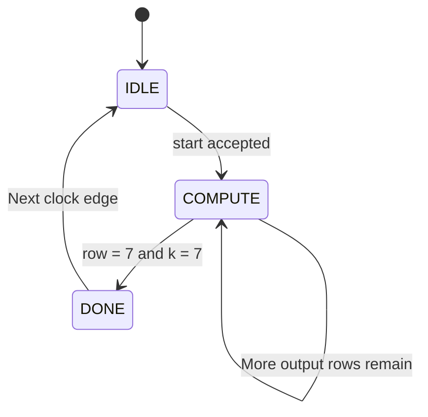

# Day 4 – Controller Design and RTL Integration

## 1. Objective

The objective is to implement the control logic for the 8×8 INT8 matrix-multiply accelerator and integrate the controller, matrix storage and MAC array.

The controller coordinates matrix loading, computation sequencing, accumulator clearing, result storage and completion notification.

## 2. FSM Architecture

A three-state finite state machine is implemented.

| State | Function |
|---|---|
| IDLE | Accept matrix loading and wait for start |
| COMPUTE | Control the eight MAC units and computation sequence |
| DONE | Assert completion for one clock cycle |

### State transitions

- IDLE → COMPUTE: When start is accepted.
- COMPUTE → COMPUTE: When additional output rows remain.
- COMPUTE → DONE: When the final output row and final multiplication term are completed.
- DONE → IDLE: On the following clock edge.

## 3. Counter Organization

Two counters control the matrix multiplication.

| Counter | Width | Function |
|---|---|---|
| row_idx | 3 bits | Selects output row |
| k_idx | 3 bits | Selects multiplication term |

Both counters range from 0 to 7.

The reduction counter increments after each multiplication-accumulation cycle. When k_idx reaches 7, the current output row is completed and the row counter increments.

## 4. Controller Signals

| Signal | Function |
|---|---|
| load_enable | Enables matrix loading in IDLE |
| mac_en | Enables MAC accumulation |
| clear_acc | Clears the eight accumulators |
| result_we | Enables result storage writes |
| row_idx | Selects the current output row |
| k_idx | Selects the current reduction index |
| busy | Indicates active computation |
| done | Indicates computation completion |

## 5. Matrix Loading

Matrix A and matrix B are stored as 64-element signed 8-bit arrays.

The load_sel signal determines which matrix is written:

- load_sel = 0: Matrix A.
- load_sel = 1: Matrix B.

The load_addr signal selects the element using row-major addressing:

\[
address=row\times8+column
\]

The load_we signal enables the write operation.

Matrix loading is permitted only when the controller is in IDLE and start is not asserted.

The external controller must load all 64 elements of both matrices before starting computation.

## 6. Computation Sequencing

The controller selects one element from matrix A and eight elements from matrix B during each computation cycle.

The selected A operand is broadcast to all eight MAC units.

Each MAC receives a different B operand and updates its accumulator.

When k_idx reaches 7:

- The current output row is completed.
- All eight results are written to result storage.
- All eight accumulators are cleared.
- The next output row is selected.

The final accumulation value is obtained from acc_value_next_bus to include the final multiplication term.

Total computation latency:

\[
8\times8=64\text{ cycles}
\]

## 7. Completion and Status Signals

The busy signal is asserted during COMPUTE.

When the final output row has been calculated:

- The final eight results are stored.
- The FSM transitions to DONE.
- busy is deasserted.
- done is asserted for one clock cycle.

The result matrix remains available for reading after computation completes.

## 8. Reset Strategy

An active-low asynchronous reset is used.

The following registers are reset:

- FSM state.
- Row counter.
- Reduction counter.
- Eight accumulator registers.

Matrix A, matrix B and result storage are not reset.

Input matrices must be loaded before computation begins. Output data is valid only after successful completion.

## 9. RTL Module Integration

The accelerator hierarchy consists of:

| Module | Responsibility |
|---|---|
| mac_unit.sv | Individual multiply-accumulate unit |
| mac_array.sv | Eight parallel MAC units |
| matrix_controller.sv | FSM and computation control |
| matrix_storage.sv | Matrix and result storage |
| matmul_top.sv | Top-level integration |

The matrix controller generates the required control signals and indices. The matrix storage supplies the operands to the MAC array and stores the completed results.

## 10. Day 4 Conclusion

The controller, matrix storage and top-level integration RTL have been implemented.

The controller coordinates the eight parallel MAC units using a three-state FSM and two 3-bit counters.

The complete accelerator hierarchy is now available for integrated functional verification.

The next stage is to develop a self-checking testbench and verify the complete accelerator using directed and random test vectors.
