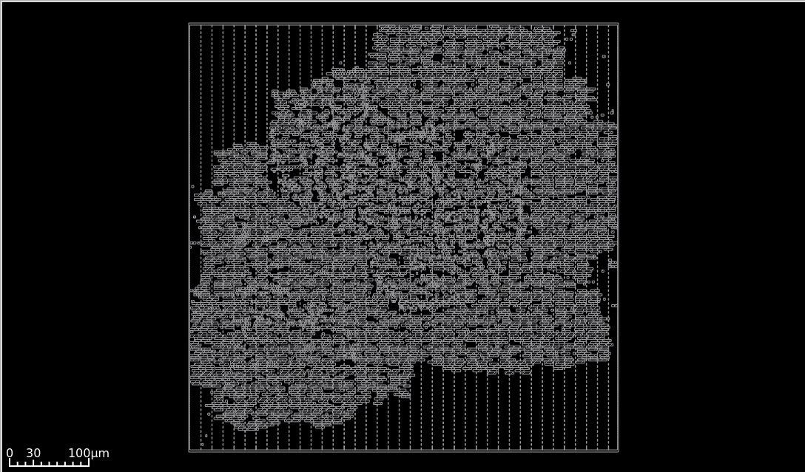
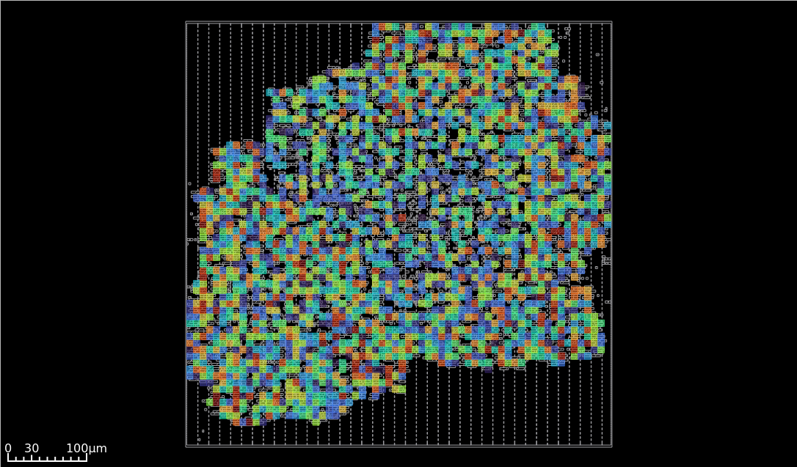
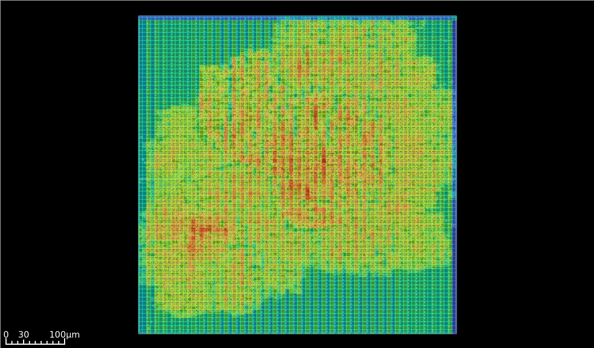

# Day 15 — Placement Baseline (Experiment B)

## 1. Objective

Establish the placement baseline for the selected floorplan (Experiment B). The Day 15 work covers global placement, detailed placement/legalization, inspection of cell distribution and estimated routing demand, and preservation of placement evidence.

The selected design is the INT8 matrix-multiplication accelerator, implemented as `matmul_top` on the Sky130HD platform.

## 2. Selected configuration

| Parameter | Value |
|---|---|
| Design nickname | `int8_matmul_expB_util40` |
| Design top | `matmul_top` |
| Platform | `sky130hd` |
| Configuration | `designs/sky130hd/int8_matmul/config_expB_util40.mk` |
| Target core utilization | 40% |
| Core aspect ratio | 1.0 |
| Placement density | 0.60 |
| Clock constraint | 10 ns (`core_clk`) |
| Constraints | Same SDC used for the Experiment B floorplan run |

Experiment B was selected on Day 14 because it provided the best overall balance of standard-cell/core area, setup timing, estimated wirelength and electrical checks among the three floorplan candidates. Experiment A had lower HPWL and better hold slack; Experiment C had slightly lower global-placement weighted congestion. Experiment B was selected as the balanced candidate, not because it won every individual metric.

## 3. Placement flow checkpoints

The Experiment B placement run already existed and was reused; the stages were not rerun for Day 15.

| Stage | Checkpoint | Purpose | Status |
|---|---|---|---|
| 3_1 | `3_1_place_gp_skip_io.odb` | Initial global placement before I/O placement | Complete |
| 3_2 | `3_2_place_iop.odb` | I/O pin placement | Complete |
| 3_3 | `3_3_place_gp.odb` | Timing- and routability-driven global placement | Complete |
| 3_4 | `3_4_place_resized.odb` | Design-rule repair / resizing | Complete |
| 3_5 | `3_5_place_dp.odb` | Detailed placement and legalization | Complete |
| Final | `3_place.odb`, `3_place.sdc` | Final placement checkpoint | Present |

All six placement databases and the final placement SDC were confirmed present in the ORFS results directory. The corresponding global-placement, resizer and detailed-placement reports, plus stage JSON metrics and logs, were also confirmed present.

## 4. Measured placement results

### 4.1 Global placement

| Metric | Result |
|---|---:|
| Core area | 285,699 µm² |
| Die area | 289,982 µm² |
| Standard-cell instance area reported at global placement | 127,869 µm² |
| Actual instance utilization | 44.7565% |
| Estimated global-placement HPWL / wirelength metric | 197,820 µm |
| Routability-driven weighted congestion metric | 0.787743 |
| Global-placement estimated Fmax | 116.834 MHz |

The 40% value is the floorplanning target. The reported actual placement utilization is approximately 44.76% after placement-stage changes such as cell sizing and buffering. These are different quantities and should not be reported interchangeably.

The weighted congestion value of 0.787743 is the global placer’s routability-driven estimate. It is not a detailed-routing congestion result and does not establish that all routing resources will be violation-free.

### 4.2 Detailed placement

| Metric | Result |
|---|---:|
| Core area | 285,699 µm² |
| Standard-cell instance area | 127,883 µm² |
| Actual detailed-placement utilization | 44.7613% |
| Final HPWL after detailed placement/mirroring | 208,319.4 µm |
| Setup worst slack | +1.45694 ns |
| Hold worst slack | +0.111435 ns |
| Setup TNS | 0 ns |
| Hold TNS | 0 ns |
| Estimated maximum frequency | 117.054 MHz |
| Placement design violations | 0 |
| Setup / hold violations | 0 / 0 |
| Max slew / max capacitance / max fanout violations | 0 / 0 / 0 |

The detailed-placement report and JSON metrics indicate positive setup and hold slack and zero reported placement, setup, hold, slew, capacitance and fanout violations at this stage.

The detailed-placement JSON also reports `detailedplace__dpl__route__wirelength__estimated = 217169`. This is an ORFS estimated route-wirelength metric; it is not the same field as the final HPWL value above. Keep the metric labels distinct when comparing results.

### 4.3 Interpretation

- Global placement produced a weighted congestion estimate of 0.787743, below the 1.0100 routability target reported for the Experiment B placement run.
- Detailed placement completed with zero reported design violations.
- The detailed-placement setup slack is positive (+1.45694 ns) and hold slack is positive (+0.111435 ns) under the current pre-CTS placement timing model.
- The estimated detailed-placement Fmax is 117.054 MHz. This is a placement-stage estimate, not a post-CTS or post-route frequency result.

## 5. Visual inspection

The following images were captured from the OpenROAD GUI using the final Experiment B placement database (`3_place.odb`).

### 5.1 Standard-cell placement

The standard-cell view shows the placed instances within the core and the distribution of whitespace around the placed logic.

### 5.2 Placement-density heatmap

The Display Control panel showed **Placement Density** enabled for this capture. The image is a qualitative view of spatial density variation; no numeric bin values are inferred from the screenshot.

### 5.3 Estimated congestion (RUDY)

The Display Control panel showed **Estimated Congestion** enabled and **Routing Congestion** disabled for this capture. This is the estimated RUDY routing-demand visualization. Higher-color regions indicate relatively higher estimated demand in the displayed map; this is not an actual global- or detailed-routing result.

Supporting GUI captures that show the selected heatmap option are archived as:

- `expB_density_display_control.png`
- `expB_rudy_display_control.png`

## 6. Engineering observations and limitations

1. The placement-density view shows a non-uniform spatial distribution of cells. This is expected for a design with clustered datapath and control logic; the screenshot alone does not identify the RTL source of each hotspot.
2. The RUDY view indicates non-uniform estimated routing demand, with relatively higher-demand regions visible within the core. This can guide later congestion-driven investigation.
3. The numeric weighted congestion metric (0.787743) comes from the global placer’s routability estimation. It must not be presented as a post-global-route or detailed-route congestion measurement.
4. The screenshots do not show completed signal routing. The project has not yet completed CTS, global routing, detailed routing, parasitic extraction or post-route STA for this candidate.
5. Timing numbers in this report are pre-CTS placement estimates. Clock-tree effects and extracted interconnect parasitics may change setup and hold timing later.

## 7. Archived source artifacts

The original ORFS artifacts are located under:

- Configuration: `designs/sky130hd/int8_matmul/config_expB_util40.mk`
- Global-placement report: `reports/sky130hd/int8_matmul_expB_util40/base/3_global_place.rpt`
- Resizer report: `reports/sky130hd/int8_matmul_expB_util40/base/3_resizer.rpt`
- Detailed-placement report: `reports/sky130hd/int8_matmul_expB_util40/base/3_detailed_place.rpt`
- Stage metrics and logs: `logs/sky130hd/int8_matmul_expB_util40/base/3_*.json` and `3_*.log`
- Final placement database: `results/sky130hd/int8_matmul_expB_util40/base/3_place.odb`
- Final placement SDC: `results/sky130hd/int8_matmul_expB_util40/base/3_place.sdc`

For repository archival, copy the text reports, JSON metrics, execution logs and final SDC into the project repository. Keep the `.odb` databases in the ORFS results directory unless the repository intentionally tracks large databases.

## 8. Day 15 conclusion

The selected Experiment B floorplan has a completed global- and detailed-placement baseline. The final detailed-placement checkpoint is legal, has positive setup and hold slack, and reports zero placement and electrical violations in the available metrics. Its global-placement weighted congestion estimate is 0.787743. The GUI placement-density and RUDY views show spatial variation that should be watched in later placement and routing stages.

**Day 15 status:** placement baseline and visual inspection complete. This is a pre-CTS, pre-route checkpoint; it is not a routed or signoff implementation.
